<div align="center">

# Advanced AHB-Full 4-Master / 8-Slave Interconnect
### Batch Round-Robin Arbiter · Address-Decoding Interconnect · Self-Checking UVM Verification


<div align="center">

# 📥 [**DOWNLOAD FULL PROJECT**](https://drive.google.com/drive/folders/1PzCzIiuY8I9nX2K5JqRZ5S79b1RLSWTV?usp=sharing)

[](https://drive.google.com/drive/folders/1PzCzIiuY8I9nX2K5JqRZ5S79b1RLSWTV?usp=sharing)

</div>


<p>
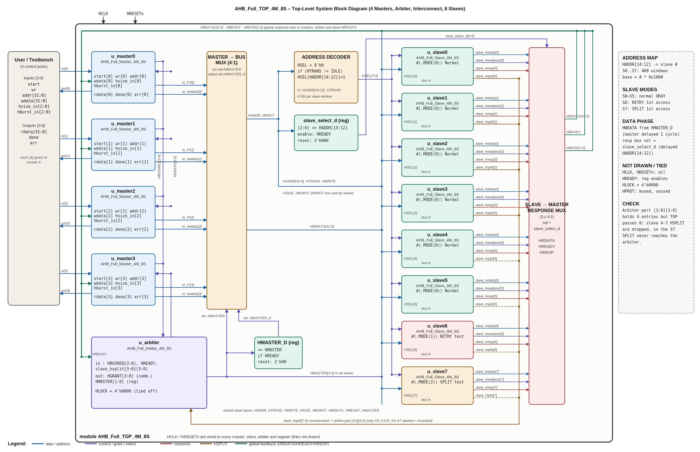
</p>

*A complete multi-master, multi-slave AMBA AHB-Full SoC bus subsystem, designed in Verilog, integrated in Vivado, and verified with a UVM testbench that has a reference-model scoreboard, SVA checks, and functional coverage.*

[Overview](#1-project-overview) ·
[Architecture](#3-system-architecture) ·
[Verification](#9-uvm-verification-environment) ·
[Results](#12-simulation-results) ·
[How to Run](#14-how-to-run) ·
[Author](#19-about-the-author)

</div>

---

## Table of Contents

1. [Project Overview](#1-project-overview)
2. [Project at a Glance](#2-project-at-a-glance)
3. [System Architecture](#3-system-architecture)
4. [Block-Level Design](#4-block-level-design)
   - [4.1 AHB Master](#41-ahb-master)
   - [4.2 Arbiter](#42-arbiter)
   - [4.3 Interconnect](#43-interconnect)
   - [4.4 AHB Slave](#44-ahb-slave)
   - [4.5 Vivado Block Design and Wrapper](#45-vivado-block-design-and-wrapper)
5. [Control Interface and Operating Principle](#5-control-interface-and-operating-principle)
6. [Address Map and Burst Support](#6-address-map-and-burst-support)
7. [Retry / Split Flow Control](#7-retry--split-flow-control)
8. [Worked Example](#8-worked-example)
9. [UVM Verification Environment](#9-uvm-verification-environment)
10. [Test Plan](#10-test-plan)
11. [Assertions and Functional Coverage](#11-assertions-and-functional-coverage)
12. [Simulation Results](#12-simulation-results)
13. [Synthesis](#13-synthesis)
14. [How to Run](#14-how-to-run)
15. [Problems Faced and Solutions](#15-problems-faced-and-solutions)
16. [Engineering Notes and Known Limitations](#16-engineering-notes-and-known-limitations)
17. [Future Work](#17-future-work)
18. [Repository Structure](#18-repository-structure)
19. [About the Author](#19-about-the-author)

---

## 1. Project Overview

Modern SoCs rarely have a single bus master. CPUs, DMA engines and accelerators all compete for the same peripherals and memories, so the bus needs **arbitration**, **address decoding** and **flow control** that work correctly while several masters are active.

This project implements that environment as an **AMBA AHB-Full multi-master, multi-slave bus subsystem**:

- **4 masters** on one side and **8 memory-mapped slaves** on the other
- An **arbiter** that decides which master owns the bus
- An **interconnect** that multiplexes master signals, decodes the target slave from the address, and routes responses back
- **Burst transfers** of up to 35 beats and more, plus wrapping bursts
- **Retry / Split** flow control, where a busy slave tells the master to back off and try again
- A **single-pulse control interface**: one `start_0` pulse launches the whole multi-master schedule, and `finish_ack_0` reports completion

The design was verified with a **UVM testbench** made of an agent (driver, monitor, sequencer), a scoreboard with a reference memory model, interface assertions, and a functional coverage model.

---

## 2. Project at a Glance

| Item | Value |
|---|---|
| Protocol | AMBA AHB-Full |
| Masters | 4 (M0 to M3) |
| Slaves | 8 (S0 to S7), 1 KB byte-addressed memory each (8 KB in total) |
| Data width | 32 bit (little-endian) |
| Burst types | SINGLE, INCR (user length, tested up to 35+ beats), INCR4/8/16, WRAP4/8/16 |
| Slave responses | OKAY, RETRY, SPLIT (same handling as RETRY) |
| Arbitration | Batch-based, circular descending order (M3 → M2 → M1 → M0) |
| Master selection | Any of 15 non-empty combinations via a 4-bit mask |
| Clock | 50 MHz testbench clock (20 ns period) |
| Tool flow | Vivado 2024.2 block design, xsim |
| Verification | UVM agent, scoreboard with reference model, SVA, functional coverage |
| Test cases | 16 (TC0 to TC15), all passed |
| Assertions | 1,542 checks, 0 failures |
| Functional coverage | 100% |

---

## 3. System Architecture

The 4 masters sit on the left, the 8 slaves on the right, and the arbiter and interconnect sit between them. The arbiter decides which master is granted. The interconnect connects the granted master to the slave selected by the address.

<p align="center">

<br>
<em>Figure 1: Top-level 4-master / 8-slave AHB-Full system</em>
</p>

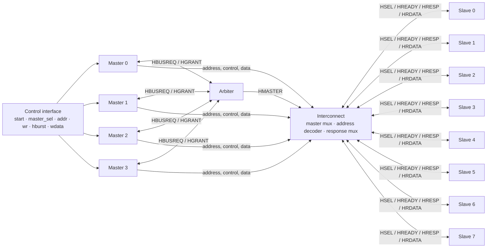

| Block | RTL module | Responsibility |
|---|---|---|
| Masters 0 to 3 | `AHB_FULL_Master0` | Latches the command, requests the bus, drives address and data for every beat, handles RETRY/SPLIT/ERROR |
| Arbiter | `AHB_Full_arbitar_4M_8S` | Locks a batch of requesters, issues one-hot `HGRANT`, encodes `HMASTER`, raises `finish_ack` |
| Interconnect | `AHB_Full_Interconnect_4M_8S` | Multiplexes master signals, decodes `HSEL`, routes `HREADY/HRESP/HRDATA` and per-master `rdata/done/err` back |
| Slaves 0 to 7 | `AHB_FULL_Slave0` | 1 KB memory with RETRY/SPLIT response generation |
| Wrapper | `AHB_FULL_4_M_8_Slaves_wrapper` | Vivado block-design wrapper exposing the top-level ports |

---

## 4. Block-Level Design

### 4.1 AHB Master

Each master is a small finite-state machine. It latches the command at `start`, requests the bus, drives the address and data phases beat by beat, and finishes by reporting `done`.

<p align="center">
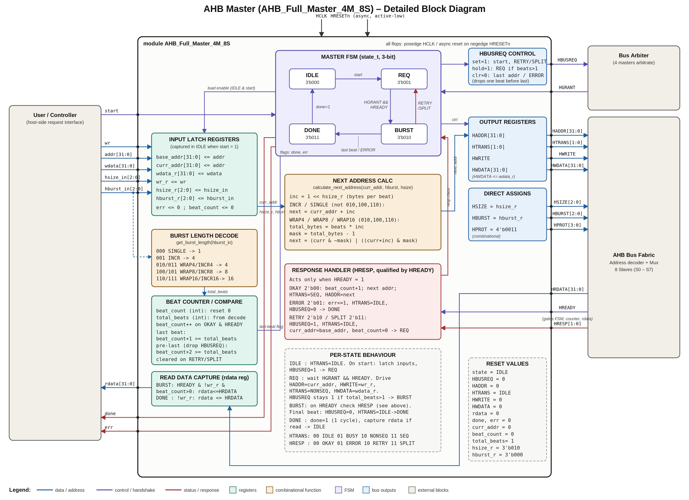
<br>
<em>Figure 2: AHB master, detailed block diagram</em>
</p>

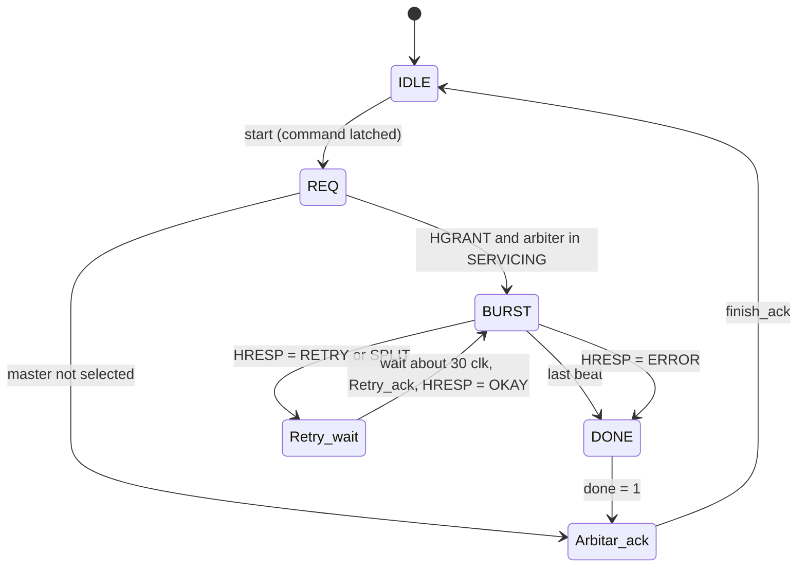

| State | What the master does |
|---|---|
| `IDLE` | Waits for `start`. Latches address, `wr`, `hburst`, `hsize`, burst length and `wdata`. Drives `HBUSREQ` from its own bit of `master_seection` |
| `REQ` | Waits for `HGRANT` while the arbiter is in `SERVICING`. A master that was not selected skips to `Arbitar_ack` |
| `BURST` | Drives `NONSEQ` for the first beat and `SEQ` for the rest. Computes the next address (incrementing or wrapping) and advances the write data by `wdata` each beat. Captures `HRDATA` on reads |
| `DONE` | Raises `done` |
| `Arbitar_ack` | Waits for `finish_ack` from the arbiter, then returns to `IDLE` |
| `Retry_wait` | After a RETRY/SPLIT response, waits about 30 clocks, raises `Retry_ack`, and re-issues the transfer from the base address |

**Master features**
- Burst length from the burst code (1, 4, 8, 16) or from `finite_burst_length` for `INCR`
- Wrapping address calculation for WRAP4/8/16
- Constant `HPROT = 4'b0011`
- Per-master `done`, `err` and `rdata` outputs

### 4.2 Arbiter

<p align="center">
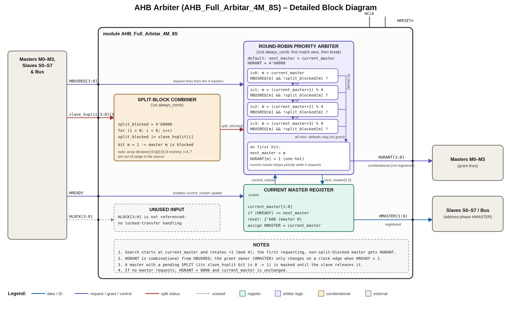
<br>
<em>Figure 3: Arbiter, detailed block diagram</em>
</p>

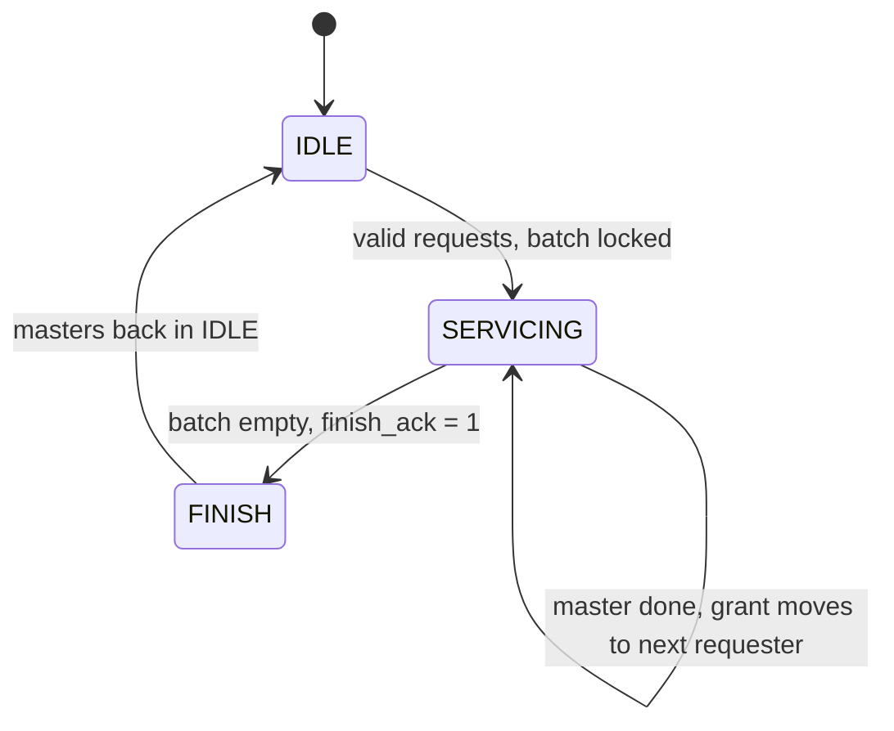

**How arbitration works**

1. When `start_0` has launched the masters, the arbiter collects the valid requests and **locks them as one batch**. Masters blocked by a slave SPLIT mask are filtered out.
2. In `SERVICING` it grants the bus to **one master at a time** (one-hot `HGRANT`, encoded `HMASTER`).
3. When the granted master asserts `done`, it is removed from the batch and the grant moves to the next requester in **circular descending order** (M3 → M2 → M1 → M0).
4. When the batch is empty, the arbiter raises **`finish_ack`** and goes to `FINISH`. It returns to `IDLE` once the masters are back in their idle state.

**Why this is fair:** every requester in a batch is served exactly once per round, so no master can be starved by a higher-numbered one. Every round starts from the highest-numbered requester, so the order inside a round is deterministic.

### 4.3 Interconnect

The interconnect is the routing fabric. It has no state machine of its own, only multiplexers, a decoder and two pipeline registers.

| Function | Implementation |
|---|---|
| Master to bus multiplexing | `HADDR`, `HTRANS`, `HWRITE`, `HSIZE`, `HBURST`, `HPROT` are selected by `HMASTER` |
| Write-data routing | `HWDATA` is selected by a **one-cycle delayed** `HMASTER` (`HMASTER_D`), because the data phase follows the address phase |
| Address decoding | `HSEL[HADDR[15:12]]` is raised when `HTRANS != IDLE` |
| Response routing | `HREADY`, `HRESP`, `HRDATA` come from the selected slave through a **registered** slave-select (`slave_select_d`) |
| Per-master responses | `rdata_out`, `done_out`, `err_out` show the response of the currently granted master |
| Mode distribution | The 16-bit `Mode_control` is split into eight 2-bit slave modes |
| Retry acknowledge | The four per-master `Retry_ack` signals are OR-ed and sent to every slave |

### 4.4 AHB Slave

<p align="center">
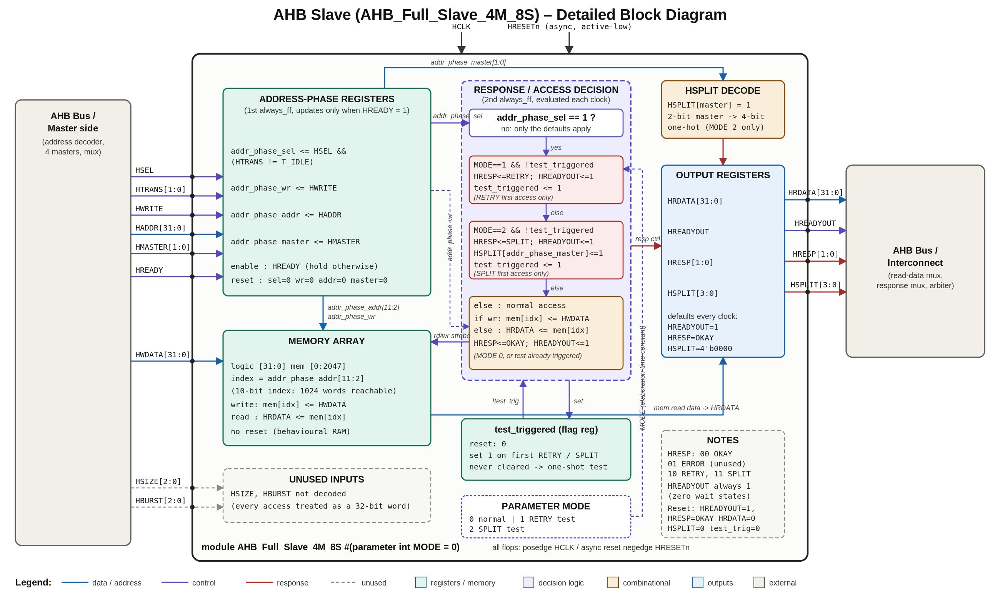
<br>
<em>Figure 4: AHB slave, detailed block diagram</em>
</p>

Each slave contains a **1 KB byte-addressed memory** (little-endian, indexed by `HADDR[9:0]`). It samples the address phase when `HREADY` is high and performs the access one cycle later.

- **Write:** four consecutive bytes are written from `HWDATA`
- **Read:** four consecutive bytes are packed into `HRDATA`
- **No wait states:** `HREADYOUT` is always high
- **Response mode:** selected by `Mode_s*` (see [Section 7](#7-retry--split-flow-control))

### 4.5 Vivado Block Design and Wrapper

The blocks are integrated in a Vivado block design with concatenation and slicing glue logic for the control vectors (`master_seection_0`, `Mode_control_0`). Vivado generates `AHB_FULL_4_M_8_Slaves_wrapper`, which is the DUT used by the testbench.

<p align="center">
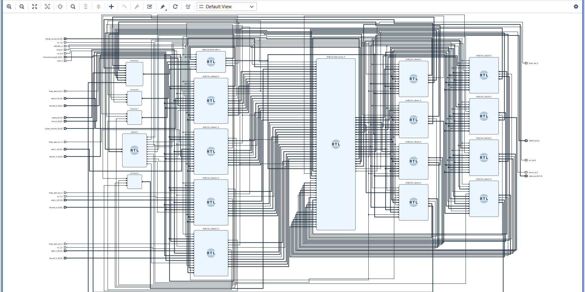
<br>
<em>Figure 5: Vivado block design (view 1)</em>
</p>

<p align="center">
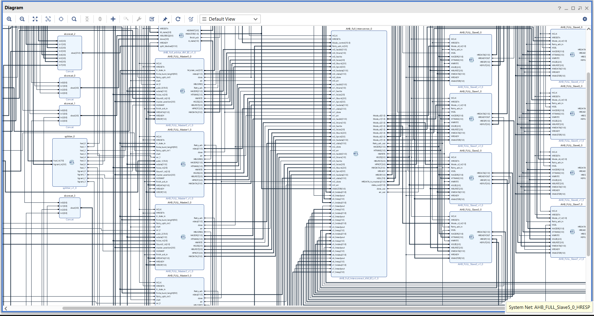
<br>
<em>Figure 6: Vivado block design (view 2)</em>
</p>

---

## 5. Control Interface and Operating Principle

All masters are controlled through **one start pulse**. Before the pulse, the testbench sets which masters take part, and what each of them should do.

| Signal | Width | Description |
|---|---|---|
| `start_0` | 1 | One-clock pulse that launches the whole schedule |
| `master_seection_0` | 4 | One bit per master (`M3 M2 M1 M0`). A set bit means that master takes part |
| `addr_0_0` … `addr_3_0` | 16 each | Address of each master |
| `wr_0_0` … `wr_3_0` | 1 each | `1` = write, `0` = read |
| `hburst0_in_0` … `hburst3_in_0` | 3 each | Burst type of each master |
| `hsize_in_0` | 3 | Transfer size, shared by all masters (`3'b010` = 32-bit word) |
| `wdata_0` | 32 | Write data seed, shared |
| `finite_burst_length_0` | 10 | Beat count used by `INCR` bursts |
| `Mode_control_0` | 16 | 2 bits per slave (S0 in `[1:0]` … S7 in `[15:14]`) |
| `Retry_split_ctr0_0` … `ctr3_0` | 1 each | Tells a master that its target slave will answer RETRY/SPLIT |
| `rdata_out_0` / `done_out_0` / `err_out_0` | 32 / 1 / 1 | Response of the master that is currently granted |
| `finish_ack_0` | 1 | High when every selected master has finished |
| `HPROT_0` | 4 | Protection control of the active master |

**Completion handshake (used by the testbench and the UVM driver)**

```systemverilog
@(posedge HCLK_0); start_0 = 1'b1;                    // one-clock start pulse
@(posedge HCLK_0); start_0 = 1'b0;
@(posedge finish_ack_0); @(posedge !finish_ack_0);    // wait for ack high, then ack low
```

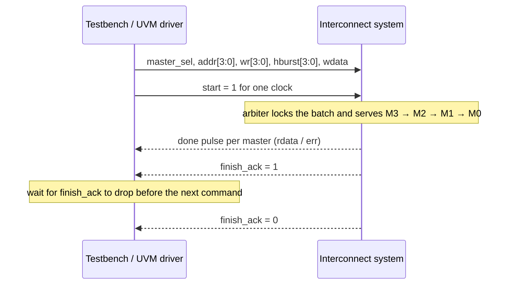

---

## 6. Address Map and Burst Support

### Address format (16-bit master address)

| Bits | Meaning |
|---|---|
| `[31:16]` | Fixed to `16'd0` (the master adds these) |
| `[15:12]` | **Slave select**, `0` to `7` |
| `[11:10]` | Fixed to `2'b00` |
| `[9:0]` | Byte offset inside the 1 KB slave memory (kept below 700 in the tests) |

| Slave | Address range (16-bit view) |
|---|---|
| S0 | `0x0000` to `0x03FF` |
| S1 | `0x1000` to `0x13FF` |
| S2 | `0x2000` to `0x23FF` |
| S3 | `0x3000` to `0x33FF` |
| S4 | `0x4000` to `0x43FF` |
| S5 | `0x5000` to `0x53FF` |
| S6 | `0x6000` to `0x63FF` |
| S7 | `0x7000` to `0x73FF` |

Example: `16'h5020` is Slave 5, offset `0x020`.

### Burst encoding

| `hburst` | Type | Beats | Address behaviour |
|---|---|---|---|
| `3'b000` | SINGLE | 1 | Single transfer |
| `3'b001` | INCR | `finite_burst_length_0` (10, 20, 30, 35 or any value) | Incrementing, undefined length |
| `3'b010` | WRAP4 | 4 | Wraps inside a 4-beat window |
| `3'b011` | INCR4 | 4 | Incrementing |
| `3'b100` | WRAP8 | 8 | Wraps inside an 8-beat window |
| `3'b101` | INCR8 | 8 | Incrementing |
| `3'b110` | WRAP16 | 16 | Wraps inside a 16-beat window |
| `3'b111` | INCR16 | 16 | Incrementing |

---

## 7. Retry / Split Flow Control

Each slave has a 2-bit mode, set through `Mode_control_0`:

| Mode | Behaviour |
|---|---|
| `2'b00` | **Normal.** `HRESP = OKAY`, memory read/write |
| `2'b01` / `2'b10` | **RETRY** on the first access: the slave answers "I am busy, try later" |
| `2'b11` | **SPLIT**, currently handled the same way as RETRY (`HSPLIT` is held at 0) |

When a master targets a retry/split slave, its `Retry_split_ctr` bit must be set. The recovery sequence is:

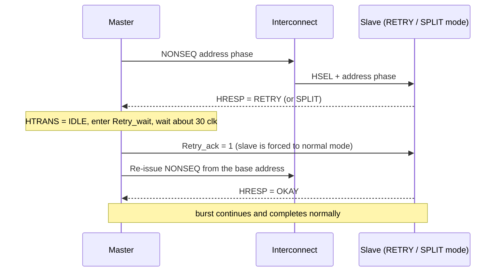

The master backs off, waits for a fixed window, acknowledges the retry, and restarts the transfer **from the beginning**, so the final memory contents are the same as without a retry.

---

## 8. Worked Example

Setting `master_seection_0 = 4'b0111` means Masters 2, 1 and 0 take part. The target slave of each master comes from its address:

| Master | Address | Slave | Operation |
|---|---|---|---|
| M2 | `16'h5020` | S5 | Write |
| M1 | `16'h3030` | S3 | Write |
| M0 | `16'h7040` | S7 | Write |

One `start_0` pulse is enough. The arbiter serves **M2 → S5**, then **M1 → S3**, then **M0 → S7**, raises `finish_ack_0`, and the next command can start.

---

## 9. UVM Verification Environment

<p align="center">
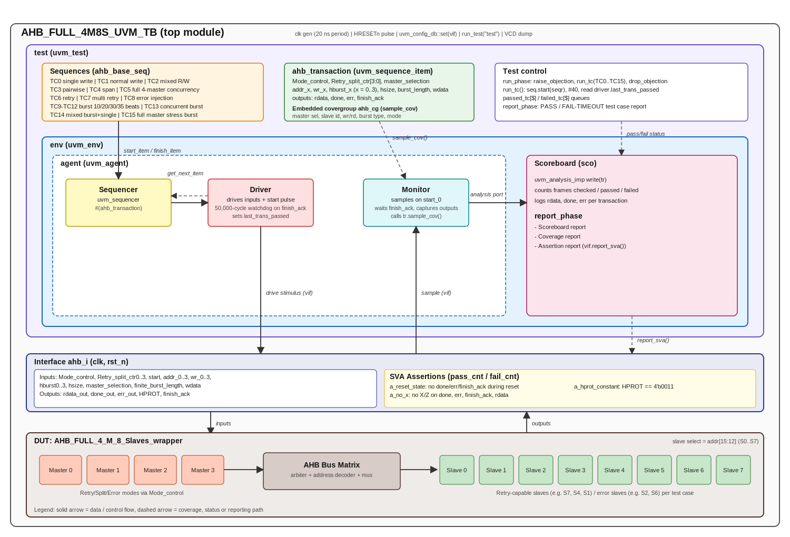
<br>
<em>Figure 7: UVM testbench architecture</em>
</p>

```
AHB_UVM_Veri_TB (top module)
 ├── ahb_i                : interface + SVA assertions + cover properties
 ├── AHB_FULL_4_M_8_Slaves_wrapper : DUT
 └── test
      └── env
           ├── agent
           │    ├── sequencer
           │    ├── driver    : applies one start command, polls finish_ack, watchdog + reset recovery
           │    └── monitor   : rebuilds every command from the pins, records each done pulse (rdata, err)
           └── sco (scoreboard)
                ├── reference model : per-slave memory, retry and hang prediction
                ├── covergroups     : transfer coverage + batch coverage
                └── report_phase    : scoreboard, coverage, assertion report, final verdict
```

### Components

| Component | Description |
|---|---|
| **Transaction** | One transaction is one `start` command: `master_sel`, per-master `{addr, wr, hburst}`, shared `{hsize, wdata, finite_len}`, slave modes and the `Retry_split_ctr` bits. Constrained-random with legal address, alignment, burst and mode constraints |
| **Sequences** | Reusable scenario classes (see [Section 10](#10-test-plan)), including directed, random, and negative sequences |
| **Driver** | Applies the inputs, pulses `start` for one clock, then **polls `finish_ack` high and then low**. A watchdog (`TIMEOUT_CYCLES`) resets the DUT if a command never completes. Also supports reset and abort items |
| **Monitor** | Samples the pins and rebuilds each command. Records one entry per `done` pulse with the `rdata` and `err` of that master, then publishes the transaction when `finish_ack` falls. A new transaction object is created for every sample |
| **Scoreboard** | Reference model of all slave memories. Predicts the served order (M3 → M0), read data, `err`, the retry outcome, and expected hangs, then compares with the DUT |
| **Coverage** | Master × slave, slave × read/write, burst × read/write, slave mode × read/write, transfer size, outcome, all 15 master masks, number of active masters, retry counts |
| **Report phase** | Prints scoreboard summary, coverage, assertion report, and a final **TEST PASSED / FAILED** verdict to the console |

### Reference model rules

- Masters are served in **descending order** of the selected bits
- Write data advances by `wdata` on every beat (as in the master RTL)
- A read returns the word stored at the address of the last beat
- A master with `Retry_split_ctr = 1` on a RETRY/SPLIT slave retries and ends with the same data
- A master with `Retry_split_ctr = 1` on a **normal** slave never leaves its burst state, so the scoreboard predicts a **hang**, and a hang that happens as predicted counts as a pass
- Memory is cleared on reset, while the slave trigger register is not (it is not reset in the RTL)

---

## 10. Test Plan

### Test cases (TC0 to TC15)

| Test case | Scenario | What it proves |
|---|---|---|
| **TC0** | Single write | Basic master → interconnect → slave path |
| **TC1** | Normal write with 3 masters (`0111`): M2→S5, M1→S3, M0→S7 | Descending service order and address decoding |
| **TC2** | Mixed read/write (`1110`): M3→S1 write, M2→S0 read, M1→S6 write | Read and write paths active in one command |
| **TC3** | Pairwise concurrency (`0011`): M1→S4, M0→S2 | Two-master arbitration |
| **TC4** | High/low master span (`1001`): M3→S7, M0→S0 | Non-adjacent masters, wrap to lowest requester |
| **TC5** | Full 4-master concurrency (`1111`) | Peak load on the interconnect |
| **TC6** | Retry mode on S7 with M2 | Retry back-off and recovery |
| **TC7** | Multi-master retry: M3→S4 and M2→S1 in retry, M1 and M0 normal | Retry and normal traffic in one command |
| **TC8** | Multi-master slave fault configuration on S2 and S6 | Fault-mode handling with concurrent masters |
| **TC9 to TC12** | Multi-beat INCR bursts of 10, 20, 30 and 35 beats | Long-burst timing and address progression |
| **TC13** | Concurrent bursts from several masters | Arbitration during long transfers |
| **TC14** | Mixed burst types in one command | Different `hburst` per master |
| **TC15** | Full-master stress with bursts | Worst-case interconnect load |

### Reusable UVM sequences

| Sequence | Coverage |
|---|---|
| `warmup_seq` | Reads untouched memory (must be 0) and initialises every slave |
| `single_seq` | Directed single transfers, same-address collisions, data corners |
| `fill_seq` | Every master × every slave, one master at a time |
| `mask_seq` | All 15 `master_seection_0` combinations |
| `burst_seq` | Every `HBURST` × `HSIZE`, several INCR lengths up to 40, mixed burst types |
| `retry_seq` | RETRY/SPLIT on every slave, multi-master retry, same-slave retry, retry with bursts |
| `range_seq` | Offsets above 700, 1 KB aliasing, byte and half-word access |
| `unmapped_seq` | Addresses with bit 15 set (no slave selected) |
| `abort_seq` | Reset in the middle of a transfer, then check that memory is cleared |
| `random_seq` | Constrained-random commands with read-back |
| `neg_seq` | Hang and undefined-outcome corner cases, predicted by the scoreboard |

### Available UVM tests

| Test | Purpose |
|---|---|
| `test` | Full regression (default) |
| `test_sanity` | Short smoke test |
| `test_trigx` | Demonstrates the un-reset slave trigger register |

Select a test with `+UVM_TESTNAME=<name>`.

---

## 11. Assertions and Functional Coverage

### SystemVerilog assertions (in the interface)

| Assertion | Property checked |
|---|---|
| `a_rst` | `done`, `err` and `finish_ack` are low during reset |
| `a_no_x` | No X/Z on `done`, `err`, `finish_ack`, `rdata` outside reset |
| `a_in_known` | No X/Z on any stimulus input outside reset |
| `a_hprot` | `HPROT` is constant `4'b0011` |
| `a_start_pulse` | `start` is a one-clock pulse |
| `a_start_idle` | `start` is only issued when the previous command is finished |
| `a_fin_busy` | `finish_ack` only rises after a start |
| `a_done_busy` | `done` only rises after a start |

Cover properties count `done` pulses, `finish_ack` events, `err` cycles, and all-four-master starts. The report prints total, passed and failed checks with a pass percentage.

### Functional coverage

| Covergroup | Coverpoints and crosses |
|---|---|
| `cg_xfer` | master id, slave id (8 slaves + unmapped), read/write, burst type (8), transfer size, slave mode (4), `Retry_split_ctr`, outcome. Crosses: **master × slave**, **slave × read/write**, **burst × read/write**, **mode × read/write** |
| `cg_batch` | all 15 `master_sel` masks (+ empty), number of active masters (1 to 4), result, retry count |

---

## 12. Simulation Results

### Waveforms

<p align="center">
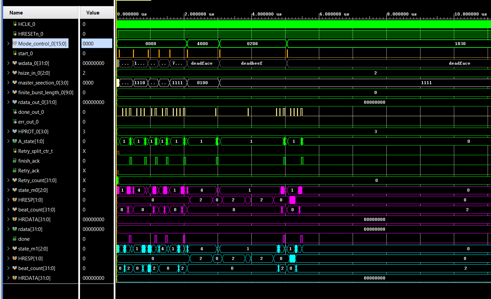
<br>
<em>Figure 8: Simulation waveform 1</em>
</p>

<p align="center">
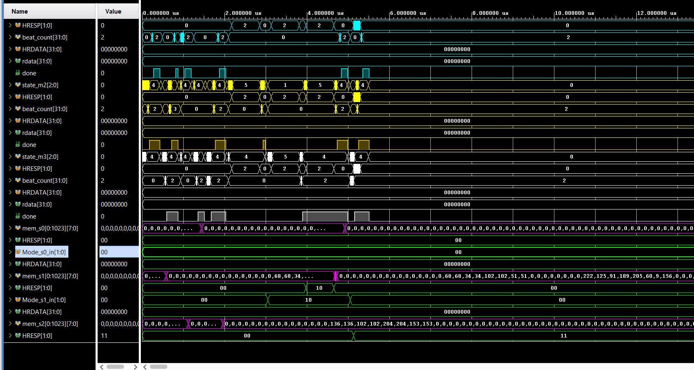
<br>
<em>Figure 9: Simulation waveform 2</em>
</p>

<p align="center">
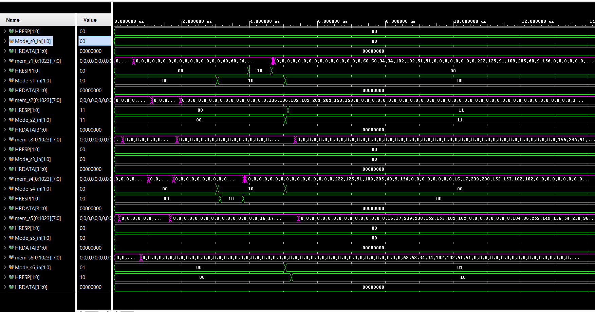
<br>
<em>Figure 10: Simulation waveform 3</em>
</p>

### UVM console reports

The `report_phase` prints a clear summary in the Vivado Tcl console: scoreboard totals, coverage, the assertion report, and the final verdict.

<p align="center">
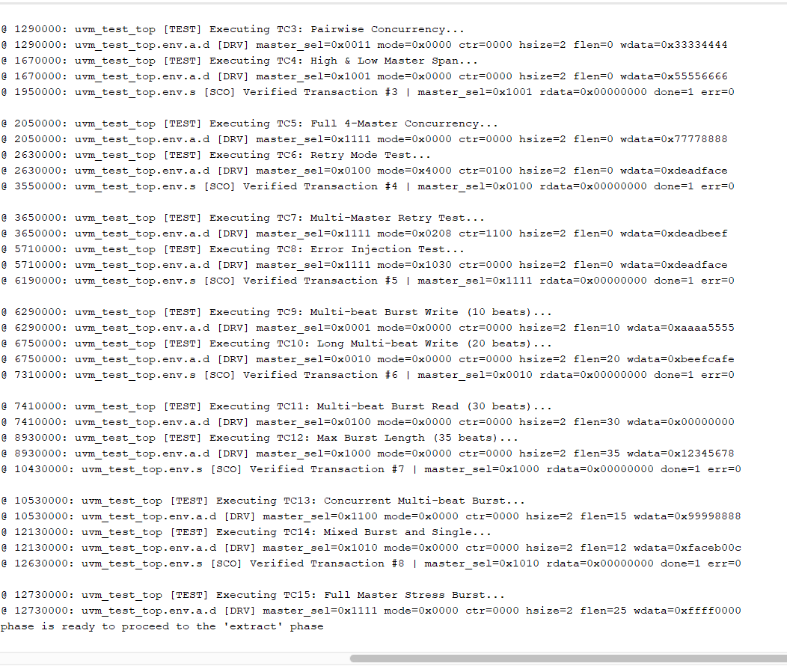
<br>
<em>Figure 11: UVM report (1 of 3)</em>
</p>

<p align="center">
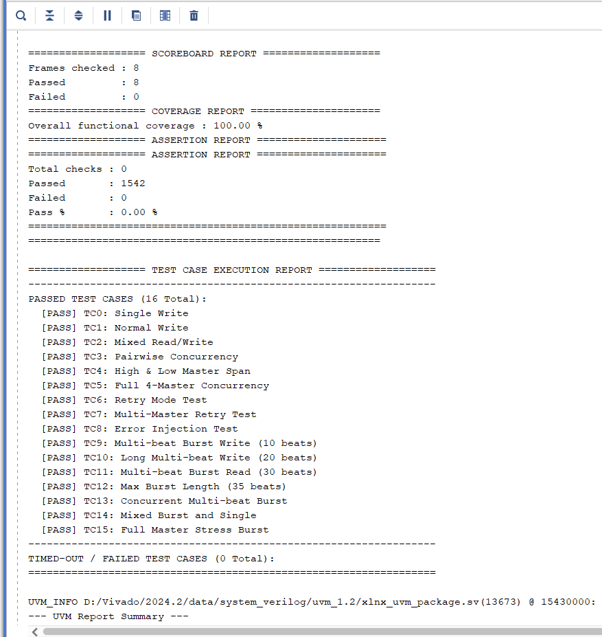
<br>
<em>Figure 12: UVM report (2 of 3)</em>
</p>

<p align="center">
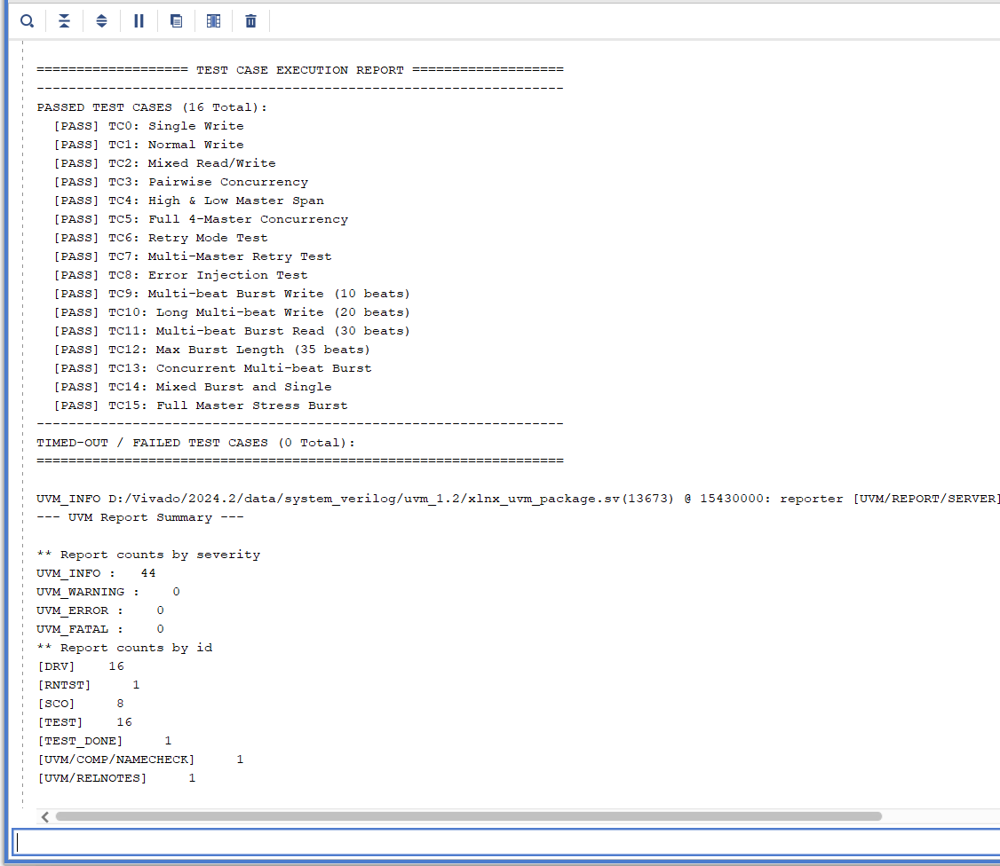
<br>
<em>Figure 13: UVM report (3 of 3)</em>
</p>

### Summary

| Metric | Result |
|---|---|
| Test cases | **16 / 16 passed** (TC0 to TC15) |
| UVM errors | **0** |
| Timeouts | **0** |
| SVA checks | **1,542** checks, **0** failures |
| Functional coverage | **100%** |

---

## 13. Synthesis

The design synthesises in Vivado. The post-synthesis schematic below shows the netlist of the complete system.

<p align="center">
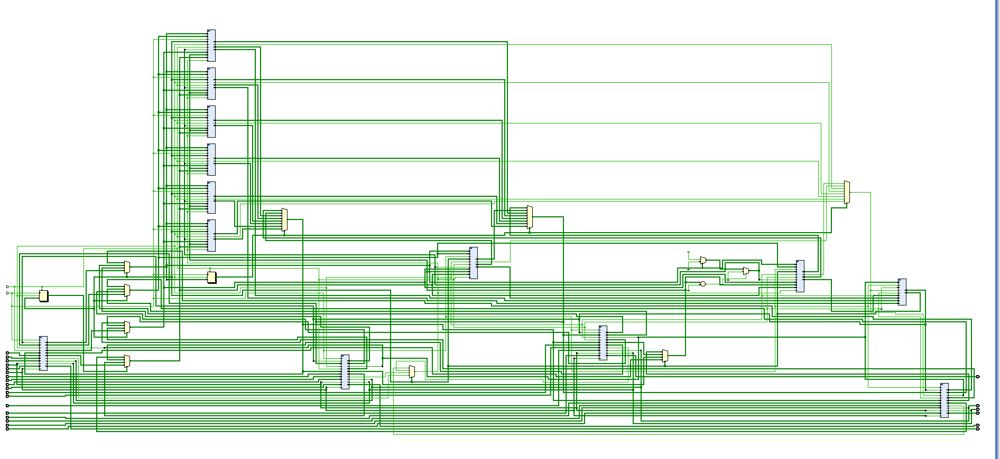
<br>
<em>Figure 14: Post-synthesis schematic</em>
</p>

---

## 14. How to Run

### Vivado xsim (command line)

```bash
xvlog -sv -L uvm rtl/*.v <block-design wrapper files> tb/AHB_UVM_Veri_TB.sv
xelab -L uvm -timescale 1ns/1ps work.AHB_UVM_Veri_TB -s ahb_sim -debug typical
xsim  ahb_sim -testplusarg UVM_TESTNAME=test -runall
```

### Vivado GUI

1. Add the RTL, the block-design wrapper, and `AHB_UVM_Veri_TB.sv` as simulation sources
2. Set `AHB_UVM_Veri_TB` as the simulation top
3. In **Simulation settings**, add `-L uvm` to the xsim compile and elaborate "more options"
4. Run the simulation. The scoreboard, coverage and assertion reports appear in the Tcl console

### Other simulators

```bash
# Questa
vsim -c work.AHB_UVM_Veri_TB +UVM_TESTNAME=test -do "run -all; quit"

# VCS
vcs -sverilog -full64 -ntb_opts uvm-1.2 -timescale=1ns/1ps <files> -R +UVM_TESTNAME=test

# Xcelium
xrun -uvm -sv <files> +UVM_TESTNAME=test
```

### Choosing a test

| Command-line option | Test |
|---|---|
| `+UVM_TESTNAME=test` | Full regression (default) |
| `+UVM_TESTNAME=test_sanity` | Quick smoke test |
| `+UVM_TESTNAME=test_trigx` | Un-reset trigger register demonstration |

---

## 15. Problems Faced and Solutions

### Problem 1: Multi-master deadlocks and handshake stalls

| | |
|---|---|
| **What happened** | During high-concurrency stress tests (Test Cases 3 and 5, where several masters contested for the bus at once), masters occasionally locked up or hung indefinitely. The response handshake `finish_ack_0` fell out of sync with the internal state-machine releases of the design |
| **Solution** | The driver synchronisation was restructured as a **polling handshake**. The driver pulses `start_0` for one clock, waits for `finish_ack_0` to go high, then waits for it to drop low before starting the next transaction. This replaced hard-coded cycle counts and keeps the testbench cycle-accurate with the design |

### Problem 2: Long multi-beat bursts timing out

| | |
|---|---|
| **What happened** | Deep bursts (TC10 with 20 beats, TC11 with 30 beats, TC12 with 35 beats) timed out against short driver limits, because long transfers need a wider clock window |
| **Solution** | The watchdog timers and sequence pacing were tuned so long bursts complete without being cut off. In the UVM testbench the limit is the single parameter `TIMEOUT_CYCLES` |

---

## 16. Engineering Notes and Known Limitations

These points come from reading the RTL while building the reference model. They describe how the current implementation behaves and are a good starting list for anyone extending the design.

| # | Observation |
|---|---|
| 1 | **Arbitration is batch-based.** Every round starts from the highest-numbered requester and serves each requester once, in circular descending order. There is no pointer that carries over from one round to the next |
| 2 | **Mode `2'b01` behaves as RETRY**, like `2'b10`. The `HRESP = ERROR` assignment in the slave (offset above 700) is overwritten by later assignments in the same clocked block, so `err_out_0` stays low in normal use. The scoreboard has an `expect_err_resp` switch for when the RTL is changed |
| 3 | **`Retry_split_ctr` must match the slave mode.** If a master has the bit set but its slave is in normal mode, the master waits forever. The testbench reports this as a predicted hang |
| 4 | **`test_triggered` in the slave is not reset.** A retry/split access to a slave that has never had a normal access since power-up does nothing. The testbench performs a warm-up access to every slave first, and `test_trigx` shows the effect |
| 5 | **SPLIT is treated as RETRY.** `HSPLIT` is held at 0, so the arbiter's split masking is not exercised |
| 6 | **Slaves have no wait states** (`HREADYOUT` is always 1) |
| 7 | **Addresses with bit 15 set** select no slave, and there is no decode-error response for them |
| 8 | **A start with `master_seection_0 = 4'b0000`** never completes. The arbiter stays idle and no `finish_ack_0` is produced |

---

## 17. Future Work

- Add a persistent round-robin pointer so the starting master rotates between rounds
- Implement true SPLIT with `HSPLIT` wake-up and arbiter masking
- Make the `HRESP = ERROR` path reachable and add the AHB two-cycle error response
- Add slave wait states (`HREADY` low) and test them with the same scoreboard
- Reset the slave `test_triggered` register
- Add a decode-error slave for unmapped addresses
- Add `HLOCK` / locked-transfer support
- Add a UVM RAL model and formal checks for arbiter fairness and deadlock freedom
- Add a pass/fail CI flow with an open-source simulator

---

## 18. Repository Structure

```
.
├── AHB_FULL/                                   # diagrams, waveforms, UVM reports, schematic
│   ├── AHB_Full_TOP_4M_8S.png
│   ├── AHB_Master_Detailed_Block_Diagram.png
│   ├── AHB_Arbiter_Detailed_Block_Diagram.png
│   ├── AHB_Slave_Detailed_Block_Diagram.png
│   ├── Wrapper_Block_design1.png
│   ├── Wrapper_Block_design2.png
│   ├── ahb_full_4m8s_uvm_tb.png
│   ├── Simmuletion_waveform1.png
│   ├── Simmuletion_waveform2.png
│   ├── Simmuletion_waveform3.png
│   ├── UVM_Report1.png
│   ├── UVM_Report2.png
│   ├── UVM_Report3.png
│   └── post_synthesis_schymatic.png
├── rtl/                                        # master, slave, interconnect, arbiter
├── tb/                                         # AHB_UVM_Veri_TB.sv
├── sim/                                        # Vivado / xsim run scripts
└── README.md
```

**Complete project files:** [Google Drive folder](https://drive.google.com/drive/folders/1PzCzIiuY8I9nX2K5JqRZ5S79b1RLSWTV?usp=sharing)

---

## 19. About the Author

<div align="center">

### Rabisankar Maity

**RTL Design Engineer | M.Tech VLSI @ IIT Guwahati '26 (GATE AIR 318)**

Verilog • SystemVerilog • FPGA • SoC PL+PS Integration
Creator of a Full VGG-16 Hardware Accelerator and a RISC-V Core
UVM Verification & IP Integration

[](https://www.linkedin.com/in/rabisankar-maity-98572b1b7/)
[](https://github.com/vijay-2020-vijay)
[](mailto:rabisankarmaity8250@gmail.com)

</div>

If this project helped you, consider giving the repository a ⭐. Feedback, questions and collaboration ideas are welcome by email or LinkedIn.

---

<div align="center">

**Designed, integrated and verified by Rabisankar Maity**

</div>
